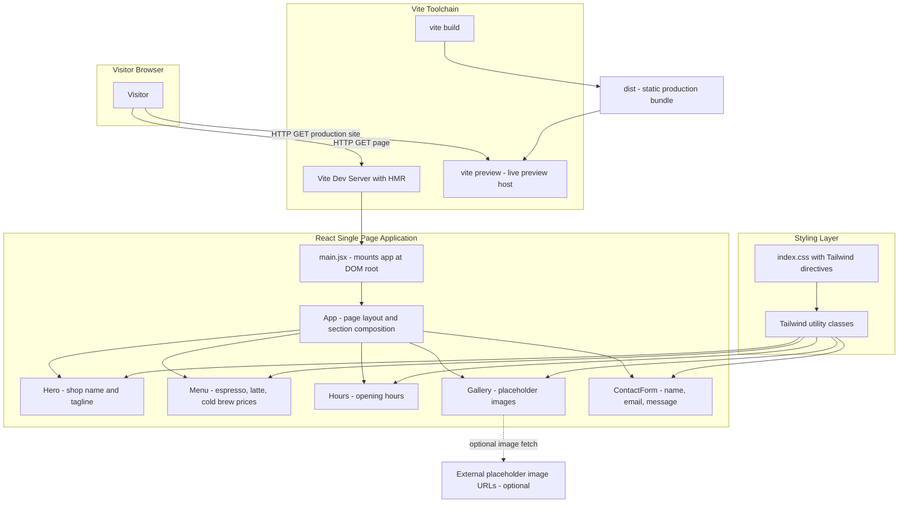
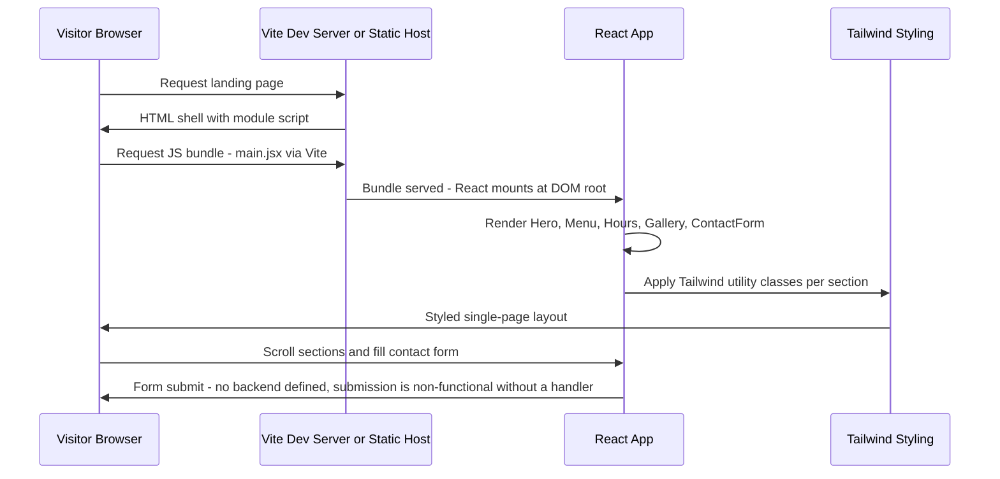

## System Overview

This repository hosts **Bean & Brew**, a single-page coffee shop landing site built with React, Vite, and Tailwind CSS. The page presents the shop's brand (hero with the verbatim tagline "Slow coffee, warm mornings"), a menu with prices for espresso, latte, and cold brew, opening hours, a photo gallery, and a contact form. There is no backend, database, or API layer — the entire experience is a client-rendered static site produced by the Vite toolchain and served via the live preview deployment step.

**Important status note:** the repository is currently empty (no files, manifests, or entry points). Everything described below is the target architecture mandated by the brief and issue, to be scaffolded from scratch.

## System Diagram

## Architecture Flow

End-to-end summary: the visitor requests the page from either the Vite dev server (development) or the static `dist` bundle served by the preview deployment step (production). React mounts once at the DOM root via `react-dom`, renders all sections as components, and Tailwind utility classes provide all styling. The only optional external calls are placeholder image fetches for the gallery. No data is persisted anywhere.

## Modules & Responsibilities

| Module (planned) | Responsibility |
|---|---|
| `main.jsx` | Entry point; mounts the React application into the DOM root using `react-dom`. |
| `App.jsx` | Top-level component; composes the landing page sections in order (hero, menu, hours, gallery, contact). |
| `Hero` | Displays shop name "Bean & Brew" and tagline "Slow coffee, warm mornings" verbatim. |
| `Menu` | Lists menu items with prices: espresso, latte, cold brew. |
| `Hours` | Displays opening hours for the shop. |
| `Gallery` | Photo gallery using placeholder images (colored divs or stock placeholder URLs), since no assets exist in the repo. |
| `ContactForm` | Contact form (name/email/message fields); currently has no submission backend — flagged as a gap. |
| `index.css` | Tailwind entry stylesheet; imports Tailwind directives/utilities used across all components. |
| `vite.config.js` | Vite configuration registering `@vitejs/plugin-react` for JSX transforms and fast refresh. |
| `package.json` | Declares dependencies (react, react-dom, vite, @vitejs/plugin-react, tailwindcss) and scripts; must be created from scratch with deliberately pinned versions. |

## Data & Integrations

- **Storage:** None. There is no database, file store, or persistence layer. All content (menu items, prices, hours, copy) is static and lives in the component code.
- **Queues:** None. No message brokers or background jobs exist or are planned.
- **External APIs:** None required. The only potential external requests are stock placeholder image URLs for the gallery; alternatively, placeholders can be pure CSS/colored divs requiring zero network calls.
- **Contact form backend:** Not specified by the brief. Without a form-handling service (e.g., a form API) or a `mailto:` fallback, form submission will be non-functional. This must be flagged to the user.
- **Tailwind CSS versioning:** Tailwind v4 (CSS-first configuration) and v3 (`tailwind.config.js`) have different setup steps; versions must be pinned deliberately when creating `package.json`, since no lockfile exists to guide this.

## Runtime & Commands

No scripts exist yet (empty repository); the following are the standard Vite commands the scaffold will provide:

| Command | Purpose |
|---|---|
| `npm install` | Install dependencies (react, react-dom, vite, @vitejs/plugin-react, tailwindcss). |
| `npm run dev` | Start the Vite dev server with HMR for local development. |
| `npm run build` | Produce the production bundle in `dist/`. |
| `npm run preview` | Serve the `dist` bundle; powers the live preview deployment step. |
| Tests | **Not available** — no test framework or test files exist or are configured. |
| Lint | **Not available** — no linter configuration exists. |

Verification currently relies solely on a successful `npm run build` and the deployed live preview.

## Conventions

- **Indentation:** 2-space indent throughout all source files.
- **Styling:** All styling via Tailwind utility classes; no separate component CSS files implied by the stack.
- **Components:** React function components composed into a single landing page, mounted once via `react-dom`.
- **Copy:** Shop name "Bean & Brew" and tagline "Slow coffee, warm mornings" must appear verbatim in the hero.
- **Scope discipline:** Build only the issue's sections — menu (espresso/latte/cold brew prices), opening hours, photo gallery placeholders, and contact form. Do not build the template's "features" or "testimonials" sections.

## Risks & Gaps

- **Empty repository:** No files, manifests, or entry points exist — the entire project must be scaffolded from scratch with no existing patterns or extension points to reuse.
- **No dependency pinning:** No `package.json` or lockfile exists; versions must be chosen fresh. Tailwind v4 vs v3 have materially different setup steps (CSS-first config vs `tailwind.config.js`), so versions must be pinned deliberately.
- **No quality gates:** No tests, linting, or CI configuration exist; verification depends entirely on a successful build and the live preview.
- **Scope ambiguity in template:** The brief's template mentions "features, testimonials" sections, but the issue requires menu, opening hours, and a photo gallery — scope must follow the issue to avoid building unrequested sections.
- **Non-functional contact form:** No backend or form-handling service is specified; without one (or a `mailto:` fallback), submission does nothing. Flag to the user.
- **Missing gallery assets:** No image assets exist in the repo; placeholders must be generated (colored divs or stock placeholder URLs).
- **Verbatim copy requirement:** The tagline and shop name must be used exactly as specified; there is no existing copy in the repo to draw from, so correctness depends on the scaffold author.