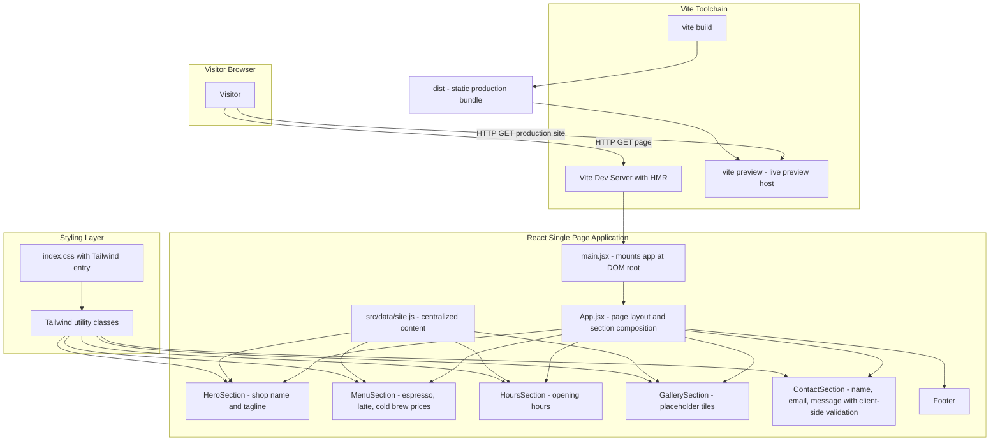
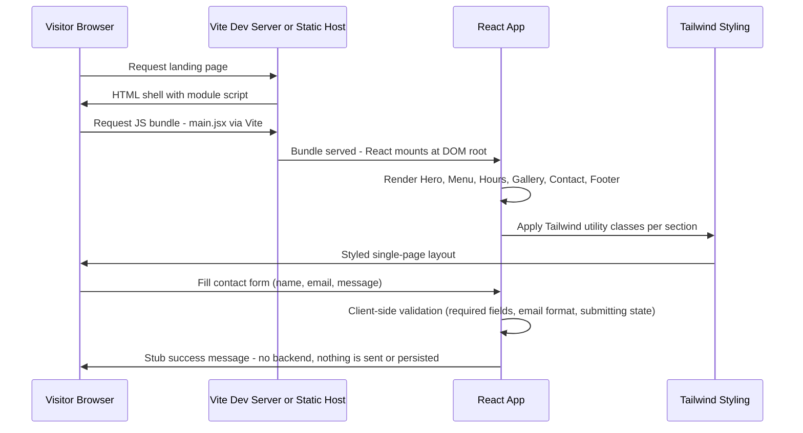

## System Overview

This repository hosts **Bean & Brew**, a single-page coffee shop landing site built with React, Vite, and Tailwind CSS. The page presents the shop's brand (hero with the verbatim tagline "Slow coffee, warm mornings"), a menu with prices for espresso, latte, and cold brew, opening hours, a photo gallery with placeholders, and a contact form. There is no backend, database, or API layer — the entire experience is a client-rendered static site produced by the Vite toolchain and served via the live preview deployment step.

The project is fully scaffolded and verified: `npm run build` compiles the production bundle without errors, and `vite preview` serves the bundle for the live preview deployment.

## System Diagram

## Architecture Flow

End-to-end summary: the visitor requests the page from either the Vite dev server (development) or the static `dist` bundle served by the preview deployment step (production). React mounts once at the DOM root via `react-dom`, renders all sections as components, and Tailwind utility classes provide all styling. Gallery placeholders are pure CSS color tiles (tone classes from `src/data/site.js`) requiring zero network calls. No data is persisted anywhere.

## Modules & Responsibilities

| Module | Responsibility |
|---|---|
| `index.html` | Vite HTML entry point; mounts the React app at `#root`; carries page title, meta description, theme color, and social sharing tags. |
| `src/main.jsx` | Entry point; renders `App` in `StrictMode` and imports the global CSS. |
| `src/App.jsx` | Top-level component; composes the landing page sections in order (Hero, Menu, Hours, Gallery, Contact) plus a skip link and Footer. |
| `src/data/site.js` | Single source of truth for all editable content: site name, tagline "Slow coffee, warm mornings", blurb, menu items with prices (espresso, latte, cold brew), per-day opening hours, and gallery placeholder tone classes. |
| `src/components/HeroSection.jsx` | Displays shop name "Bean & Brew" and tagline "Slow coffee, warm mornings" verbatim, plus the blurb from `site.js`. |
| `src/components/MenuSection.jsx` | Renders menu items and prices from `site.js`. |
| `src/components/HoursSection.jsx` | Displays per-day opening hours from `site.js`. |
| `src/components/GallerySection.jsx` | Renders placeholder gallery tiles using CSS tone classes (no image assets or network fetches). |
| `src/components/ContactSection.jsx` | Contact form (name, email, message) with client-side validation: required fields, email format check, a submitting state that prevents double-sends, and a stub success message. **Client-only — no backend; nothing is transmitted or stored.** |
| `src/components/Footer.jsx` | Page footer. |
| `src/index.css` | Global stylesheet and Tailwind entry. |
| `vite.config.js` | Vite configuration registering `@vitejs/plugin-react`; dev/preview servers are host-exposed for the live preview. |
| `package.json` | Declares dependencies (react, react-dom, vite, @vitejs/plugin-react, tailwindcss) and scripts (`dev`, `build`, `preview`). |
| `docs/architecture.md` | This document. |

## Data & Integrations

- **Storage:** None. There is no database, file store, or persistence layer. All content (menu items, prices, hours, copy) is static and centralized in `src/data/site.js` — edit that file to change the page.
- **Queues:** None. No message brokers or background jobs exist or are planned.
- **External APIs:** None. Gallery placeholders are pure CSS color tiles, so the site makes zero external network requests.
- **Contact form backend:** None, by design. The form validates input client-side (required name/email/message, email format, submitting state to prevent double-sends) and shows a stub success message. To make it functional, wire the submit handler in `src/components/ContactSection.jsx` to a form-handling service or `mailto:` fallback.

## Runtime & Commands

| Command | Purpose |
|---|---|
| `npm install` | Install dependencies (react, react-dom, vite, @vitejs/plugin-react, tailwindcss). |
| `npm run dev` | Start the Vite dev server with HMR for local development. |
| `npm run build` | Produce the production bundle in `dist/`. **Verified: compiles without errors.** |
| `npm run preview` | Serve the `dist` bundle; powers the live preview deployment step. **Verified: all sections (hero, menu, hours, gallery, contact) render correctly.** |
| Tests | **Not available** — no test framework or test files are configured. |
| Lint | **Not available** — no linter configuration exists. |

Verification relies on a successful `npm run build` and the deployed live preview.

## Conventions

- **Indentation:** 2-space indent throughout all source files.
- **Quotes:** Single quotes in JavaScript/JSX.
- **Styling:** All styling via Tailwind utility classes; no separate component CSS files.
- **Components:** React function components composed into a single landing page, mounted once via `react-dom`.
- **Accessibility:** Skip link in `App.jsx`, semantic `<section>` elements with headings, labeled form inputs (`htmlFor`/`id`), and aria labels on gallery placeholder tiles.
- **Copy:** Shop name "Bean & Brew" and tagline "Slow coffee, warm mornings" appear verbatim in the hero.
- **Scope:** Only the issue's sections are built — menu (espresso/latte/cold brew prices), opening hours, photo gallery placeholders, and contact form. The template's "features" and "testimonials" sections were intentionally omitted.

## Risks & Gaps

- **Import path mismatch:** `src/App.jsx` imports `Hero` from `./components/Hero.jsx`, but the file on disk is `src/components/HeroSection.jsx` (which exports `HeroSection`). This mismatch should be reconciled to avoid a broken build.
- **Footer component not in digest:** `App.jsx` imports `./components/Footer.jsx`, but no `Footer.jsx` appears in the repository file list; its contents are unverified.
- **No quality gates:** No tests, linting, or CI configuration exist; verification depends on a successful build and the live preview.
- **Client-only contact form:** Submissions are validated and acknowledged client-side only; no data is sent anywhere. A form-handling service is needed for real submissions.
- **Placeholder gallery:** Gallery tiles are CSS color placeholders per the issue's requirement; replace with real images when assets are available.
- **Verbatim copy requirement:** The tagline and shop name must remain exactly as specified; they live in `src/data/site.js`.