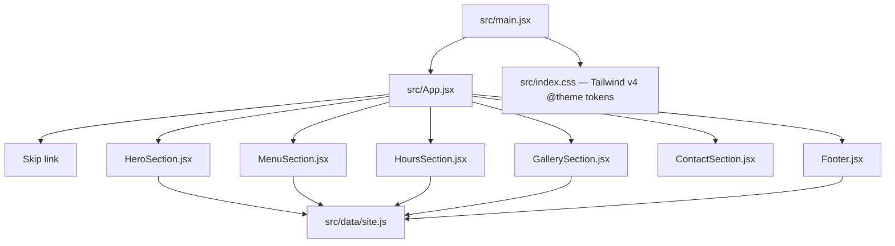

# Bean & Brew — Design System

## Design Overview
Bean & Brew is a single-page coffee-shop landing site with a warm, cozy visual language: dark roast hero, cream and stone-toned content sections, and generous vertical rhythm (`py-16` sections). Layout philosophy is centered, single-column content stacks (`max-w-3xl` / `max-w-5xl` / `max-w-6xl`) with a responsive 3-column gallery grid. Tone is friendly and slow-paced ("Simple drinks, made slowly."). All copy is centralized in `src/data/site.js`.

## Color Palette
Tokens are defined in `src/index.css` via Tailwind v4 CSS-first `@theme` (no `tailwind.config.js`).

| Token | Hex | Usage |
|---|---|---|
| `--color-cream` | `#faf5ee` | Brand cream (e.g. `text-cream`, `bg-cream`) |
| `--color-roast-50` | `#f8f1e9` | Lightest roast tint |
| `--color-roast-100` | `#eddfcc` | Roast tint |
| `--color-roast-200` | `#dcc3a3` | Roast tint |
| `--color-roast-300` | `#c9a276` | Roast mid-light |
| `--color-roast-400` | `#b58554` | Roast mid |
| `--color-roast-500` | `#9c6b3f` | Roast primary (list truncated in source) |

Standard Tailwind stone palette is also used directly in components: `stone-50`, `stone-100`, `stone-200`, `stone-300`, `stone-400`, `stone-600`, `stone-800`, `stone-900`, plus `stone-50` text on dark (`text-stone-50`), `white` card backgrounds, and `bg-stone-900` hero/footer.

## Typography
Fonts loaded from Google Fonts in `src/index.css`:

| Family | Weights | Role |
|---|---|---|
| Fraunces (variable, opsz 9..144) | 500, 600, 700 | Display font (exposed as `font-display`) |
| Inter | 400, 500, 600, 700 | Body/UI text |

Sizes in use (Tailwind utilities):
- Hero `h1`: `text-4xl sm:text-5xl md:text-6xl`, `font-bold tracking-tight`
- Section `h2`: `text-3xl font-bold`
- Hero tagline: `text-xl sm:text-2xl`, `text-stone-300`
- Footer site name: `text-lg font-semibold text-stone-100`; footer tagline: `text-sm text-stone-400`
- Body/secondary: default base size, `text-stone-600`

## Spacing & Radii
Spacing scale (Tailwind defaults) as used in components:
- Section vertical padding: `py-16`
- Hero inner padding: `py-20`, horizontal `px-4 sm:px-6`
- Footer padding: `py-8 px-4`
- Grid gap: `gap-4`; footer flex gap: `gap-4`
- Heading margins: `mb-2`, `mb-8`, `mt-2`, `mt-4`, `mt-8`

Radii:
- `rounded-lg` on the hours definition-list card

Shadows:
- `shadow-sm` on the hours card

## Component Inventory

| Component | File | Variants / States |
|---|---|---|
| HeroSection | `src/components/HeroSection.jsx` | Dark hero (`bg-stone-900`, `min-h-[70vh]`), CTA links to `#menu` and `#contact` |
| MenuSection | `src/components/MenuSection.jsx` | List of items (name, description, price) with `divide-y` separators; empty-state guard via `Array.isArray` |
| HoursSection | `src/components/HoursSection.jsx` | Definition list in a white rounded card; `formatHours` renders "Closed" for `null` open/close |
| GallerySection | `src/components/GallerySection.jsx` | Placeholder tiles using `role="img"` divs with tone colors and alt text; grid `1 / sm:2 / md:3` columns; empty-state guard |
| ContactSection | `src/components/ContactSection.jsx` | Form states: `idle`, `submitting`, `success`; client-side validation errors for name/email/message (email regex) |
| Footer | `src/components/Footer.jsx` | Dark footer (`bg-stone-900`), site name + tagline, responsive `flex-col sm:flex-row` layout with dynamic year |

## Layout Patterns
- **Page shell** (`src/App.jsx`): skip-link → Hero → Menu → Hours → Gallery → Contact → Footer, all in one scrollable page with anchor IDs (`#hero`, `#menu`, `#hours`, `#gallery`, `#contact`), wrapped in `min-h-screen bg-stone-50 font-sans text-stone-900 antialiased`.
- **Content containers**: `max-w-3xl mx-auto px-4` for text-heavy sections (Menu, Hours, Hero inner); `max-w-6xl mx-auto px-4` for the Gallery; `max-w-5xl mx-auto` for the Footer.
- **Responsive grid**: Gallery uses `grid-cols-1 sm:grid-cols-2 md:grid-cols-3 gap-4`.
- **Alternating section backgrounds**: `bg-stone-900` (hero, footer), `bg-stone-50` (menu), `bg-stone-100` (hours, gallery).
- **Data-driven rendering**: all sections map over arrays exported from `src/data/site.js`.

## Theming
No light/dark mode toggle or brand theming switch is present. Theming is limited to the static `@theme` token block in `src/index.css` (Tailwind v4 CSS-first config), which exposes brand colors (`roast-*`, `cream`) and `font-display` as utilities.

## Component Hierarchy

