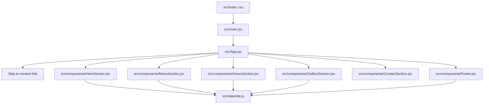

# Bean & Brew — Design System

## Design Overview

Bean & Brew is a single-page coffee-house site with a warm, editorial visual language. Sections alternate between light stone backgrounds (`stone-50`, `stone-100`) and dark bands (`stone-900` hero and footer), with a custom "roast" coffee palette and cream base defined as Tailwind theme tokens. Layout philosophy is simple and content-first: centered, max-width containers (`max-w-3xl` / `max-w-6xl`), generous vertical rhythm (`py-16`), and a single-column flow of sections composed in `src/App.jsx`. All editable content (site name, tagline, menu, hours, gallery) lives in `src/data/site.js`.

## Color Palette

Tokens are defined in `src/index.css` via Tailwind CSS-first `@theme` config (no `tailwind.config.js`).

| Token | Hex | Usage |
| --- | --- | --- |
| `--color-cream` | `#faf5ee` | Brand cream base |
| `--color-roast-50` | `#f8f1e9` | Lightest roast tint |
| `--color-roast-100` | `#eddfcc` | Roast tint |
| `--color-roast-200` | `#dcc3a3` | Roast tint |
| `--color-roast-300` | `#c9a276` | Roast mid-light |
| `--color-roast-400` | `#b58554` | Roast mid |
| `--color-roast-500` | `#9c6b3f` | Roast primary |
| `--color-roast-*` (600–900) | not shown in excerpt | Darker roast shades (truncated in source) |

In components, the stock Tailwind stone scale is used heavily: `bg-stone-900` / `text-stone-50` (hero), `bg-stone-900` / `text-stone-300` (footer), `bg-stone-100` (gallery, hours), `bg-stone-50` (menu, app root), `text-stone-800`/`text-stone-900` (headings), `text-stone-600`/`text-stone-400` (body), `divide-stone-200` (list separators), `bg-white` (cards). The footer highlights the site name with `text-amber-200`.

## Typography

Fonts are loaded from Google Fonts in `src/index.css`:

| Family | Weights | Role |
| --- | --- | --- |
| Fraunces (variable, opsz 9..144) | 500, 600, 700 | Display font, exposed as `font-display` utility |
| Inter | 400, 500, 600, 700 | Body/UI text |

Sizes and weights as used in components:

| Context | Classes |
| --- | --- |
| Hero site name (`h1`) | `text-4xl font-bold tracking-tight sm:text-5xl md:text-6xl` |
| Hero tagline | `text-xl text-stone-300 sm:text-2xl` |
| Section headings (`h2`) | `text-3xl font-bold` |
| Footer site name | `text-lg font-semibold text-amber-200` |
| Footer tagline / copyright | `text-sm` / `text-xs` |
| Section body copy | `text-stone-600` (default size) |

## Spacing & Radii

Spacing scale (Tailwind defaults, as used in code):

- Section vertical padding: `py-16`
- Container horizontal padding: `px-4`, `sm:px-6`
- Hero inner padding: `py-20`
- Footer padding: `py-10`
- Heading margins: `mb-2`, `mb-8`, `mt-1`, `mt-2`, `mt-4`, `mt-8`
- Grid/list gaps: `gap-4`

Border-radius values in use:

- `rounded-lg` — hours definition-list card (`HoursSection.jsx`)

## Component Inventory

| Component | File | Variants / States |
| --- | --- | --- |
| App shell | `src/App.jsx` | Composes Hero, Menu, Hours, Gallery, Contact sections, skip-to-content link, Footer; root wrapper `min-h-screen bg-stone-50 font-sans text-stone-900 antialiased` |
| HeroSection | `src/components/HeroSection.jsx` | Dark full-bleed hero; two CTAs: "View our menu", "Get in touch" |
| MenuSection | `src/components/MenuSection.jsx` | List of drink items with name, description, price; `divide-y` rows |
| HoursSection | `src/components/HoursSection.jsx` | Definition list from `hours` data; divided rows in a white card; `formatHours` renders `open – close`, or "Closed" when `open`/`close` is `null` |
| GallerySection | `src/components/GallerySection.jsx` | Responsive grid of placeholder tiles: colored `aspect-ratio` boxes with `role="img"` and alt text |
| ContactSection | `src/components/ContactSection.jsx` | Form states: `idle` \| `submitting` \| `success`; fields name/email/message; client-side validation (email regex `EMAIL_RE`), per-field errors, simulated submit via `setTimeout` |
| Footer | `src/components/Footer.jsx` | Dark band (`bg-stone-900`); centered site name (`text-amber-200`), tagline, dynamic © year |
| Site data | `src/data/site.js` | Exports `site` (name, tagline), `menu`, `hours` (open/close, `null` for Sunday), `gallery` |

Note: `MenuSection.jsx` imports `menuItems` and `GallerySection.jsx` imports `galleryItems`, while `site.js` exports `menu` and `gallery` — aliases must exist for these to resolve (see repo risks).

## Layout Patterns

- **Page shell**: `src/App.jsx` renders a skip-to-content link, then stacked full-width sections in order: Hero → Menu → Hours → Gallery → Contact, followed by the Footer. Each section owns its own background color to create alternating bands.
- **Containers**: centered max-width wrappers — `max-w-3xl mx-auto px-4` (Menu, Hours, Hero inner) and `max-w-6xl mx-auto px-4` (Gallery, Footer).
- **Hero**: `min-h-[70vh]` flex centered (`flex items-center justify-center`), dark background, centered text content.
- **Responsive grid**: Gallery uses `grid grid-cols-1 sm:grid-cols-2 lg:grid-cols-3 gap-4` — 1 column mobile, 2 at `sm`, 3 at `lg`.
- **Lists**: Menu and Hours use `divide-y divide-stone-200` row separators; Hours wraps its `dl` in a white card with `shadow-sm`.
- **Typography rhythm**: responsive heading sizes via `sm:`/`md:` breakpoints (hero only); section headings fixed at `text-3xl`.

## Theming

Light theme only — no dark mode or brand theming switch is present. Theming is centralized in the `@theme` block of `src/index.css` (Tailwind CSS-first config), where brand tokens (`cream`, `roast-*`, `font-display`) are exposed to utilities such as `bg-roast-700`, `text-cream`, and `font-display`.

## Component Hierarchy

