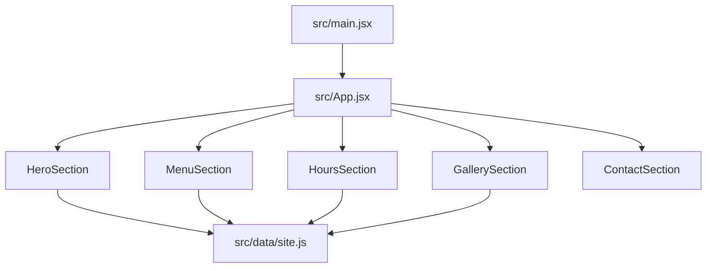

Let me analyze the provided information carefully.

The repo is a React + Vite + Tailwind CSS v4 project called "Bean & Brew" — a coffee shop site. The tone file is `src/index.css` which contains Tailwind CSS v4 CSS-first config with `@theme` tokens.

Key facts from the tone file (`src/index.css`):
- Tailwind CSS v4 CSS-first config — `@theme` tokens replace tailwind.config.js
- Brand colors exposed as utilities like `bg-roast-700`, `text-cream`, `font-display`
- Google Fonts import: Fraunces (weights 500, 600, 700, with optical size axis 9..144) and Inter (weights 400, 500, 600, 700)
- Color tokens visible:
  - `--color-cream: #faf5ee`
  - `--color-roast-50: #f8f1e9`
  - `--color-roast-100: #eddfcc`
  - `--color-roast-200: #dcc3a3`
  - `--color-roast-300: #c9a276`
  - `--color-roast-400: #b58554`
  - `--color-roast-500: #9c6b3f`
  - `--color-roast` — the file is truncated here ("--color-roast" cut off). So roast-600, roast-700, etc. are mentioned in the comment (`bg-roast-700`) but their hex values are NOT visible in the excerpt. I must not invent hex values. So I should list the tokens with known hex values and note that the scale continues (roast-600, roast-700 referenced in comments/components) but values beyond roast-500 are truncated/not shown. Actually the comment says "bg-roast-700" is a valid utility, so roast-700 exists, but I don't have its hex. I should be honest: list known hexes, note roast-600/700 exist per the comment but values are not captured in the excerpt.

Wait — the instructions say "table of tokens with actual hex values pulled from the tone files." So I should only include hex values I actually have. I can mention that the scale extends to at least roast-700 (referenced in the CSS comment) but the hex values for roast-600+ are not present in the provided excerpt. That's the honest approach.

Also `font-display` is mentioned — Fraunces is presumably `--font-display` (display font) and Inter is the body font. The comment says "font-display" utility exists. The @theme block is truncated so I can't see `--font-display` definition, but the Google Fonts import loads Fraunces and Inter, and the comment mentions `font-display`. I can reasonably state: Fraunces is the display font (exposed as `font-display`), Inter is the body/sans font. But I should be careful — the truncated file doesn't show the font token definitions. The comment explicitly says "exposed to utilities as e.g. bg-roast-700, text-cream, and font-display" — so `font-display` exists as a utility. Given Fraunces is a display serif and Inter is a sans, it's a reasonable inference that font-display → Fraunces. I'll phrase it carefully: "Fraunces (loaded via Google Fonts, exposed as the `font-display` utility)" — hmm, is that inventing? The comment lists font-display among the exposed utilities, and Fraunces is the only display-typeface loaded. I think it's safe to say Fraunces is the display face and Inter the body face, noting the @theme block is truncated. Actually, to be safe, I'll say: fonts loaded are Fraunces (500/600/700) and Inter (400–700); the `font-display` utility referenced in the file's header comment maps to the display face (Fraunces). I'll add a note that the @theme block is truncated in the source excerpt.

Hmm, but the instruction says "Do not invent patterns the code does not show." The connection Fraunces = display font is a mild inference. I'll present it with a hedge: "the file's header comment exposes a `font-display` utility; given the loaded families, Fraunces serves as the display face and Inter as the body face." That's transparent.

Now, do the components actually use these brand tokens? Looking at the component excerpts:
- GallerySection: `bg-stone-100`, `text-stone-800`, grid `grid-cols-1 sm:grid-cols-2 lg:grid-cols-3 gap-4`
- HeroSection: `bg-stone-900 text-stone-50`, `min-h-[70vh]`, `max-w-3xl`, `text-4xl sm:text-5xl md:text-6xl`, `tracking-tight`, `text-stone-300`
- HoursSection: `bg-stone-100 py-16`, `max-w-3xl`, `text-3xl font-bold text-stone-900`, `divide-y divide-stone-200 rounded-lg bg-white shadow-sm`, `dl` list
- MenuSection: `bg-stone-50 py-16 px-4`, `max-w-3xl`, `text-3xl font-bold text-stone-900`, `text-stone-600`, `divide-y divide-stone-200`, `ul`
- ContactSection: form with state: values {name, email, message}, errors, status 'idle' | 'submitting' | 'success', email regex validation.

Interesting: the components use Tailwind's default `stone` palette, not the custom roast/cream tokens (at least in the excerpts shown). The index.css comment says brand colors are exposed as bg-roast-700, text-cream etc., but the visible components use stone-* utilities. I should document both: the custom theme tokens defined in index.css, and note that the section components shown primarily use Tailwind's built-in stone palette. That's accurate and grounded.

Typography sizes seen in code:
- Hero h1: `text-4xl sm:text-5xl md:text-6xl`, `font-bold`, `tracking-tight`
- Hero p: `text-xl sm:text-2xl`, `text-stone-300`
- Section h2: `text-3xl font-bold`
- Body: `text-stone-600` (default base size)
- Font weights used: font-bold (700); Inter loaded at 400/500/600/700; Fraunces at 500/600/700.

Spacing:
- Section vertical padding: `py-16`
- Container horizontal padding: `px-4`, `sm:px-6`
- Gaps: `gap-4` (gallery grid), `mt-4`, `mt-2`, `mt-8`, `mb-8`, `mb-2`
- Hero: `py-20`, `min-h-[70vh]`

Radii:
- `rounded-lg` on the Hours dl card. That's the only radius visible. I should say rounded-lg is the only radius observed; no other radii in the excerpts.

Layout patterns:
- Single-page app: App.jsx composes HeroSection, MenuSection, HoursSection, GallerySection, ContactSection (from import graph: App → MenuSection, HoursSection, GallerySection, ContactSection; HeroSection exists too and imports site.js — likely also imported by App, though the sample graph doesn't show App → HeroSection explicitly. Hmm, the import graph sample shows App.jsx → MenuSection, HoursSection, GallerySection, ContactSection. HeroSection.jsx → site.js is shown but App → HeroSection isn't in the sample. It says "Import graph (sample)" so it may be truncated. I can say App composes section components including Hero (HeroSection exists and pulls site data). To be safe: "App.jsx composes the page from section components (MenuSection, HoursSection, GallerySection, ContactSection per the import graph; HeroSection provides the hero and also reads site data)." Actually it's reasonable to include HeroSection in the hierarchy since it's clearly part of the page. I'll include it but the mermaid graph — I could show App → HeroSection too. The sample graph might just be incomplete. I think including Hero under App is fine and low-risk; it's a landing-page section. Alternatively I can note it. I'll include it in the diagram since it's a section component of the same page; the "sample" qualifier suggests partial graph.

- Section anchors: each section has an `id` (hero, menu, hours, gallery, and presumably contact) — suggests anchor navigation. No nav component is shown though. I should not invent a navbar. I can say sections expose ids for anchor linking; no dedicated nav component appears in the excerpts.
- Container pattern: `max-w-6xl mx-auto px-4` (gallery), `max-w-3xl mx-auto px-4` (hours, hero), `max-w-3xl mx-auto` with outer `px-4` (menu). So content is centered with max-width containers.
- Responsive: mobile-first grid `grid-cols-1 sm:grid-cols-2 lg:grid-cols-3`; hero text scales `text-4xl sm:text-5xl md:text-6xl`; padding steps `px-4 sm:px-6`.
- Data-driven rendering: components map over data from `src/data/site.js` (site, menuItems, galleryItems, hours).
- Accessibility: `aria-labelledby` on gallery section with heading id.

Theming:
- Light theme only; no dark mode or brand theming mechanism visible (no `dark:` variants, no `.dark` class, no CSS variables for theme switching beyond static tokens). So: "Dark mode: not present." The @theme tokens define a single warm light palette.

Component inventory table:
| Component | File | Variants/states |
- HeroSection | src/components/HeroSection.jsx | static hero; dark background (bg-stone-900), responsive type scale
- MenuSection | src/components/MenuSection.jsx | list with divide-y rows; data-driven from menuItems
- HoursSection | src/components/HoursSection.jsx | definition list card (rounded-lg, bg-white, shadow-sm, divide-y); data-driven from hours
- GallerySection | src/components/GallerySection.jsx | responsive 1/2/3-column grid; data-driven from galleryItems
- ContactSection | src/components/ContactSection.jsx | form states: idle / submitting / success; per-field validation errors (name, email, message); email format regex
- App | src/App.jsx | page shell composing sections
- main.jsx | entry, renders App

Color palette table:
Tokens with hex:
- cream #faf5ee
- roast-50 #f8f1e9
- roast-100 #eddfcc
- roast-200 #dcc3a3
- roast-300 #c9a276
- roast-400 #b58554
- roast-500 #9c6b3f
- roast-600+ — referenced (e.g., bg-roast-700 in the file comment) but hex values not present in the provided excerpt. I'll add a note row or footnote.

Also Tailwind default stone palette used in components: stone-50, stone-100, stone-200, stone-300, stone-600, stone-800, stone-900, white. These are Tailwind defaults, not custom hexes in the tone file. Should I list their hex values? The instruction says "actual hex values pulled from the tone files." The stone values aren't in the tone file. I could list them as "Tailwind default stone scale (used directly in components)" without hexes, or include Tailwind's known default hexes — but those aren't "pulled from the tone files." Safer: list the custom tokens with hexes, then a short note that section components use Tailwind's built-in stone palette (stone-50–stone-900) and white, which are Tailwind defaults rather than custom tokens. I won't fabricate stone hexes... Actually, Tailwind's stone hexes are well-known defaults (stone-50 #fafaf9, stone-100 #f5f5f4, stone-200 #e7e5e4, stone-300 #d6d3d1, stone-600 #57534e, stone-800 #292524, stone-900 #1c1917). Including them could be helpful but the instruction says pull from tone files. I'll list custom tokens with hexes and mention stone usage without hexes, or maybe include them in a second small table labeled as Tailwind v4 defaults. Hmm. The instruction: "table of tokens with actual hex values pulled from the tone files." I'll keep the main table to tone-file tokens, and add a note about stone usage. That's cleanest and compliant.

Typography section:
- Display face: Fraunces (variable optical size 9–144, weights 500/600/700), loaded via Google Fonts; exposed via `font-display` utility per the file header comment.
- Body face: Inter (400/500/600/700).
- Sizes in code: h1 text-4xl → sm:text-5xl → md:text-6xl with tracking-tight; hero lede text-xl → sm:text-2xl; section headings text-3xl font-bold; body text default (text-stone-600 paragraphs).
- Weights: font-bold (700) for headings; Inter ships 400–700.

Spacing & radii:
- Section rhythm: py-16 for all content sections; hero py-20 with min-h-[70vh].
- Containers: max-w-3xl (hero, menu, hours), max-w-6xl (gallery); centered with mx-auto; gutters px-4, stepping to sm:px-6 in hero.
- Vertical rhythm inside sections: mt-2, mt-4, mt-8, mb-2, mb-8.
- Grid gap: gap-4.
- Radii: rounded-lg (hours card). No other radii observed.

Layout patterns:
- Single-page landing layout: main.jsx → App.jsx → stacked full-width sections, each with its own background (stone-900 hero, stone-50 menu, stone-100 hours/gallery) creating alternating bands.
- Each section: semantic <section> with id anchor (hero, menu, hours, gallery; contact presumably id="contact" — not shown in excerpt; ContactSection excerpt is truncated before JSX return. I shouldn't claim id="contact". I'll say sections carry ids for in-page navigation).
- Centered max-width containers.
- Responsive: mobile-first, sm/lg breakpoints for grid columns; sm/md for hero type; sm:px-6 gutters.
- Data-driven content from src/data/site.js.
- No router (no route files found) — single page.

Theming:
- Not present beyond the single light warm palette. No dark mode variants or theme switching observed. Tailwind v4 CSS-first @theme is the theming mechanism (tokens → utilities).

Component hierarchy Mermaid:

ContactSection doesn't import site.js per the graph, so I won't draw that edge. HeroSection → site.js is in the graph. Good.

Mermaid labels: no parentheses — fine. Quoted labels are fine.

Design overview: warm coffee-house aesthetic ("Bean & Brew"), light cream/stone surfaces with dark hero band, generous vertical rhythm, centered narrow containers, simple typographic hierarchy (bold Fraunces/Inter headings over muted stone body text), content driven from a central site data module. Tone: calm, slow, "Simple drinks, made slowly."

Now, about the truncated roast scale: the excerpt ends at "--color-roast" mid-line for roast-500... actually it shows roast-500: #9c6b3f then "--color-roast" truncated (that would be roast-600's line beginning). The comment mentions bg-roast-700. So roast-600 and roast-700 (and possibly more) exist but hexes unknown. I'll include a footnote.

Also note: the components shown use stone utilities rather than the roast/cream brand tokens — worth an honest observation in the overview or palette section: "the custom roast/cream tokens are defined and exposed, while the section components captured here primarily use Tailwind's built-in stone scale." That's grounded and useful.

Font sizes: Tailwind defaults: text-4xl = 2.25rem, 5xl = 3rem, 6xl = 3.75rem, 3xl = 1.875rem, xl = 1.25rem, 2xl = 1.5rem. Should I include rem values? These are Tailwind defaults, not in the tone file. I could include them as helpful context but flag them as Tailwind defaults. I think listing the utility classes is safest; adding rem equivalents is standard Tailwind knowledge and low-risk. I'll include the classes primarily, maybe with rem in parentheses marked as Tailwind defaults. Keep it simple: list classes.

Let me draft the document.

Structure:
# Design System — Bean & Brew (docs/design.md)? The output should be the markdown document content. I'll start with a title.

Sections required in order:
1. ## Design Overview
2. ## Color Palette
3. ## Typography
4. ## Spacing & Radii
5. ## Component Inventory
6. ## Layout Patterns
7. ## Theming
8. ## Component Hierarchy

Write it now.

Color palette table:

| Token | Hex | Utility example | Notes |
|---|---|---|---|
| --color-cream | #faf5ee | text-cream, bg-cream | Warm off-white brand base |
| --color-roast-50 | #f8f1e9 | bg-roast-50 | Lightest roast tint |
| --color-roast-100 | #eddfcc | | |
| --color-roast-200 | #dcc3a3 | | |
| --color-roast-300 | #c9a276 | | |
| --color-roast-400 | #b58554 | | |
| --color-roast-500 | #9c6b3f | | Mid roast brown |
| --color-roast-600 / 700 | not captured | bg-roast-700 referenced in file header | Scale continues past roast-500; hex values truncated in source excerpt |

Note about stone usage.

Typography:

| Role | Font | Weight(s) | Size classes | Where |
- Display/headings: Fraunces (opsz 9–144) — 500/600/700 loaded; exposed as font-display utility per index.css header. Hmm — but the headings in the components just use font-bold; no font-display class appears in the excerpts. So I should say: Fraunces is loaded and a font-display utility is exposed; the captured section headings use font-bold with default sans unless font-display is applied elsewhere (not visible in excerpts). Be careful. Actually the components don't set font-family classes at all in the excerpts, so they'd inherit the default body font. The @theme block is truncated so we can't see whether --font-sans is overridden to Inter. Tailwind v4 default sans doesn't include Inter. But since the site imports Inter, presumably --font-sans is set to Inter in the truncated part. I can't confirm. I'll present: fonts loaded (Fraunces 500–700, Inter 400–700); font-display utility exposed; the @theme font token definitions are below the truncation point, so exact --font-* bindings aren't visible; captured components rely on inherited body font + font-bold.

Sizes table:
- Hero H1: text-4xl → sm:text-5xl → md:text-6xl, font-bold, tracking-tight
- Hero lede: text-xl → sm:text-2xl
- Section H2: text-3xl, font-bold
- Section lede/body: default size, text-stone-600 / text-stone-300 (hero)

Spacing & radii:
- Scale: Tailwind default spacing (4px base) — utilities observed: py-16, py-20, px-4, sm:px-6, gap-4, mt-2, mt-4, mt-8, mb-2, mb-8.
- Radii: rounded-lg only (hours card). No other radii observed.

Component inventory:

| Component | File | Variants / states |
| App | src/App.jsx | Page shell; composes all sections |
| HeroSection | src/components/HeroSection.jsx | Static; dark band (bg-stone-900 / text-stone-50); responsive heading scale |
| MenuSection | src/components/MenuSection.jsx | Data-driven list (menuItems); divide-y rows |
| HoursSection | src/components/HoursSection.jsx | Data-driven definition list (hours); card treatment: bg-white, rounded-lg, shadow-sm, divide-y |
| GallerySection | src/components/GallerySection.jsx | Data-driven grid (galleryItems); 1/2/3 columns at base/sm/lg; aria-labelledby |
| ContactSection | src/components/ContactSection.jsx | Form; status: idle | submitting | success; per-field errors for name/email/message; email regex validation |

Careful with the pipe character in "idle | submitting | success" inside a markdown table — need to escape: `idle` / `submitting` / `success`. Use slashes.

Layout patterns:
- Single-page, no router (no route files found). main.jsx mounts App; App stacks full-width sections.
- Alternating background bands: stone-900 hero → stone-50 menu → stone-100 hours → stone-100 gallery.
- Sections are semantic <section> elements with id anchors (hero, menu, hours, gallery) for in-page navigation; no dedicated nav component in the captured code.
- Container: centered max-w-3xl (hero, menu, hours) / max-w-6xl (gallery) with mx-auto and px-4 gutters (sm:px-6 in hero).
- Responsive: mobile-first; gallery grid grid-cols-1 sm:grid-cols-2 lg:grid-cols-3; hero type text-4xl sm:text-5xl md:text-6xl; hero min-h-[70vh].
- Content sourced from src/data/site.js (site, menuItems, galleryItems, hours) — presentation components are data-driven.

Theming:
- Single light, warm theme. Tailwind v4 CSS-first @theme in src/index.css defines tokens → utilities (bg-roast-700, text-cream, font-display). No dark-mode variants, no theme switching, no secondary brand theming observed → "dark mode: not present."

Component Hierarchy mermaid:

```mermaid
flowchart TD
  M["src/main.jsx"] --> A["src/App.jsx"]
  A --> H["HeroSection.jsx"]
  A --> ME["MenuSection.jsx"]
  A --> HO["HoursSection.jsx"]
  A --> G["GallerySection.jsx