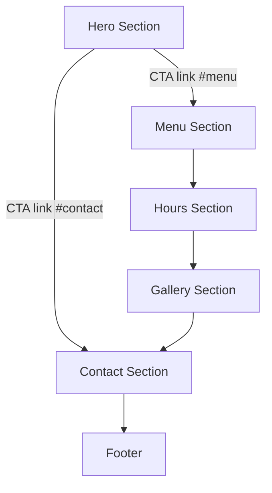

# docs/pages.md

## Page Inventory

| Route/Path | Screen File | Purpose |
|---|---|---|
| `/` (single page, no URL routing) | `src/App.jsx` | Landing page for "Bean & Brew" coffee shop: Hero, Menu, Hours, Gallery, Contact sections plus Footer |

This is a single-page static site rendered by Vite + React. There is no router; navigation happens via in-page anchor links (`#menu`, `#contact`, etc.).

## Sections Per Page

**Home (`src/App.jsx`)** renders, in order:

1. **Skip link** — accessibility link jumping to the main content (`#main-content`).
2. **Hero** (`src/components/HeroSection.jsx`) — full-width dark section (`min-h-[70vh]`, `bg-stone-900`) with site name (`siteInfo.name`), tagline (`siteInfo.tagline`), and CTA links to `#menu` and `#contact`.
3. **Menu** (`src/components/MenuSection.jsx`) — `#menu` section listing menu items (name, description, price) as a divided `<ul>` from `menuItems` data.
4. **Hours** (`src/components/HoursSection.jsx`) — `#hours` section rendering opening hours as a definition list from `hours` data; `formatHours()` renders "Closed" for days with `null` open/close values.
5. **Gallery** (`src/components/GallerySection.jsx`) — `#gallery` section with a responsive grid of placeholder tiles (`role="img"`, alt text, tone colors) from `galleryItems` data.
6. **Contact** (`src/components/ContactSection.jsx`) — `#contact` section with a validated contact form (name, email, message) and success state.
7. **Footer** (`src/components/Footer.jsx`) — dark footer (`bg-stone-900`) showing site name, tagline, and dynamic copyright year from `siteInfo`.

## Navigation Flow

All transitions are in-page anchor scrolls; there are no route changes.

## Data Per Page

**Home page** — all content sourced from `src/data/site.js` (single source of truth):

| Section | Data consumed | Interactive state |
|---|---|---|
| Hero | `siteInfo.name`, `siteInfo.tagline` | None |
| Menu | `menuItems` (name, description, price) | None |
| Hours | `hours` (day, open, close — `null` values render as "Closed" via `formatHours`) | None |
| Gallery | `galleryItems` (placeholder tiles with alt text/tone) | None |
| Contact | None (form input only) | `useState`: `values` (name/email/message), `errors`, `status` (`idle` \| `submitting` \| `success`) |
| Footer | `siteInfo.name`, `siteInfo.tagline` | None |

The contact form performs client-side validation (email regex `EMAIL_RE`) and simulates submission with `setTimeout`; no backend call is made.

## View States

- **Loading:** None — all content is static data rendered synchronously; no fetch/loading spinners.
- **Empty:** Menu and Gallery guard with `Array.isArray(...) && length > 0`, so empty arrays render the section heading with no list/grid.
- **Error:** Contact form only — inline per-field validation errors (`errors` state) shown on invalid name/email/message.
- **Submitting:** Contact form disables/indicates via `status === 'submitting'` during the simulated submit.
- **Success:** Contact form shows a success state (`status === 'success'`) after the simulated submit resolves.
- **Closed days:** Hours section handles `null` open/close values by rendering "Closed" instead of raw `null`.

## Responsive Behavior

- **Hero:** Heading scales `text-4xl` → `sm:text-5xl` → `md:text-6xl`; tagline `text-xl` → `sm:text-2xl`; container padding `px-4` → `sm:px-6`.
- **Gallery:** Grid is `grid-cols-1` on mobile, `sm:grid-cols-2` at the `sm` breakpoint, `md:grid-cols-3` at the `md` breakpoint.
- **Footer:** Stacks vertically (`flex-col`) on mobile, switches to a horizontal row (`sm:flex-row`) at the `sm` breakpoint; text alignment moves from centered to left-aligned at `sm`.
- **Menu / Hours / Contact:** Constrained-width centered containers (`max-w-3xl`, `max-w-6xl` for gallery) with consistent `px-4` padding; no additional breakpoint-specific behavior observed.
- Tailwind utility classes are used throughout (Tailwind CSS-first config in `src/index.css`).