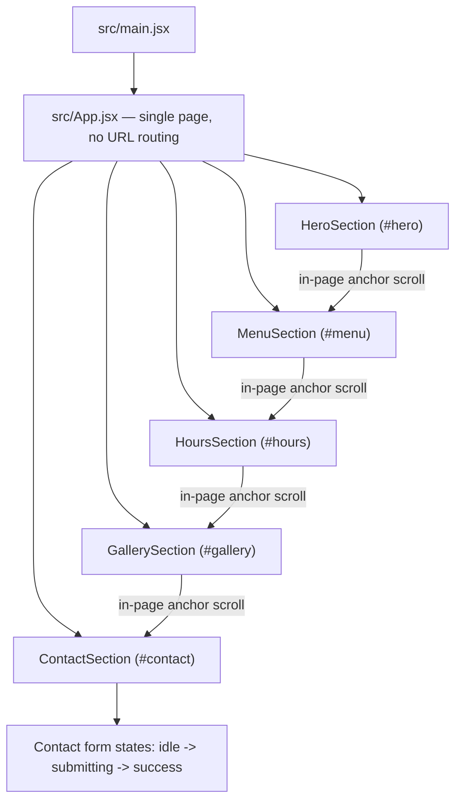

# Page Inventory

| Route/path | Screen file | Purpose |
| --- | --- | --- |
| No URL routing (single view, in-page anchors: `#hero`, `#menu`, `#hours`, `#gallery`, `#contact`) | `src/App.jsx` | Single-page marketing site for the café ("Bean & Brew") that composes all section components; navigation happens by scrolling to section anchors, not via routes |

There are no route/page files and no router in the code. `src/main.jsx` mounts `src/App.jsx`, which renders the full page as a stack of sections.

## Sections Per Page

**Single page — `src/App.jsx`** renders the following sections top to bottom:

| Order | Section id | Component | Renders |
| --- | --- | --- | --- |
| 1 | `#hero` | `src/components/HeroSection.jsx` | Full-width hero banner with the site name (`site.name`) and tagline (`site.tagline`) centered over a dark background |
| 2 | `#menu` | `src/components/MenuSection.jsx` | "Menu" heading, subtitle ("Simple drinks, made slowly."), and a divided list of drinks from `menuItems` |
| 3 | `#hours` | `src/components/HoursSection.jsx` | "Opening Hours" heading, invitation copy, and a definition list (`dl`) of day/hours entries from `hours` |
| 4 | `#gallery` | `src/components/GallerySection.jsx` | "Gallery" heading and a responsive image grid built from `galleryItems` |
| 5 | `#contact` | `src/components/ContactSection.jsx` | Contact form with `name`, `email`, and `message` fields, inline validation errors, and submit status feedback |

All content components read their copy/data from `src/data/site.js` (`site`, `menuItems`, `hours`, `galleryItems`).

## Navigation Flow

There are no screen-to-screen transitions; the only "flow" is vertical scrolling between anchored sections and the contact form's internal state machine.

## Data Per Page

**Single page (`src/App.jsx`)** — all displayed data is static content from `src/data/site.js`; no API calls or data fetching appear in the code:

| Section | Data source | Displays |
| --- | --- | --- |
| Hero | `site` (`src/data/site.js`) | Café name and tagline |
| Menu | `menuItems` (`src/data/site.js`) | List of drink items (keyed by `item.name`) |
| Hours | `hours` (`src/data/site.js`) | Day/hours pairs rendered as a `dl` list |
| Gallery | `galleryItems` (`src/data/site.js`) | Grid of image items (keyed by `item.id`-style field) |
| Contact | Local component state only | Form fields `name`, `email`, `message` held in `values` state; no backend service or fetch is shown — submission is handled client-side through the `status` state machine |

The contact form validates locally: `email` is checked against a regex (`EMAIL_RE`), and per-field messages are stored in an `errors` state object.

## View States

- **Contact form (`ContactSection.jsx`)** — the only stateful view in the app:
  - `idle` — initial form state.
  - `submitting` — set while the submit handler runs.
  - `success` — confirmation state after submit.
  - Field-level **error** state via the `errors` object (e.g., invalid email format).
- **Menu, Hours, Gallery, Hero** — render static data directly from `src/data/site.js`; there are no loading, empty, or error branches in these components (data is hardcoded, so lists are never fetched or empty at runtime).

## Responsive Behavior

Responsive rules are implemented with Tailwind CSS v4 utility breakpoints (`sm` ≈ 640px, `md` ≈ 768px, `lg` ≈ 1024px) found in the section components:

- **Gallery** — grid collapses from 3 columns to 1: `grid-cols-1 sm:grid-cols-2 lg:grid-cols-3` with `gap-4`.
- **Hero** — typography scales up across breakpoints (`text-4xl` → `sm:text-5xl` → `md:text-6xl` for the heading; `text-xl` → `sm:text-2xl` for the tagline); horizontal padding increases from `px-4` to `sm:px-6`; the section fills at least `min-h-[70vh]`.
- **Menu / Hours** — constrained to a narrow readable column (`max-w-3xl`) with `px-4` gutters, so they reflow naturally on small screens without extra breakpoints.
- **Gallery container** — wider `max-w-6xl` wrapper with `px-4` gutters.
- Brand theming (cream/roast palette, `font-display` via Fraunces, Inter body font) is defined as CSS-first `@theme` tokens in `src/index.css` rather than a Tailwind config file.