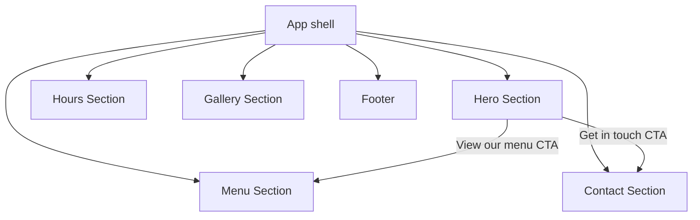

# docs/pages.md

## Page Inventory

| Route/Path | Screen File | Purpose |
|---|---|---|
| `/` (single page, no URL routing) | `src/App.jsx` | Single-page site shell composing all sections: Hero, Menu, Hours, Gallery, Contact, plus skip-to-content link and Footer |

This is a single-screen React SPA with no router. All content is rendered as anchored sections on one page (`#hero`, `#menu`, `#hours`, `#gallery`, `#contact`).

## Sections Per Page

**App (`src/App.jsx`)** renders, in order:

1. **Skip-to-content link** — accessibility shortcut to main content.
2. **HeroSection** (`src/components/HeroSection.jsx`) — full-height hero (`min-h-[70vh]`, dark `bg-stone-900`) showing site name and tagline from `site` data, with two CTAs: "View our menu" and "Get in touch".
3. **MenuSection** (`src/components/MenuSection.jsx`) — "Menu" heading with subtitle "Simple drinks, made slowly."; a divided `<ul>` of drink items (name, description, price) from `menuItems` data.
4. **HoursSection** (`src/components/HoursSection.jsx`) — "Opening Hours" heading with invite copy; a `<dl>` definition list of day/time entries from `hours` data, with a `formatHours` helper that renders "Closed" for null open/close.
5. **GallerySection** (`src/components/GallerySection.jsx`) — "Gallery" heading with a responsive grid of placeholder tiles (colored aspect-ratio boxes with `role="img"` and alt text) from `galleryItems` data.
6. **ContactSection** (`src/components/ContactSection.jsx`) — contact form with name/email/message fields, client-side validation, simulated submit, and success state.
7. **Footer** (`src/components/Footer.jsx`) — dark footer showing site name, tagline, and dynamic copyright year from `site` data.

## Navigation Flow

Navigation is anchor-based within the single page; the hero CTAs link to the `#menu` and `#contact` sections. There are no route transitions.

## Data Per Page

**Home page (`/`)** — all content sourced from `src/data/site.js`:

| Section | Data consumed | Interaction / Submission |
|---|---|---|
| Hero | `site.name`, `site.tagline` | Anchor CTAs only |
| Menu | `menuItems` array (name, description, price) | Display only |
| Hours | `hours` array (day + open/close times; null renders "Closed") | Display only |
| Gallery | `galleryItems` array (placeholder tiles with alt text) | Display only |
| Footer | `site.name`, `site.tagline`, current year | Display only |
| Contact | Local state only: `values` (name/email/message), `errors`, `status` (`idle` \| `submitting` \| `success`) | Client-side validation via email regex (`EMAIL_RE`); submit is simulated with `setTimeout` — no real backend |

## View States

- **Contact form** is the only stateful view:
  - **Idle** — empty form with inline field errors as the user types/submits invalid values (required fields, email format via `EMAIL_RE`).
  - **Submitting** — transient state during the simulated `setTimeout` submit.
  - **Success** — confirmation state shown after the simulated submit completes.
- **Loading / empty / error**: no async data fetching exists, so there are no loading spinners, empty-state placeholders, or error boundaries. Menu, Hours, and Gallery render directly from static data (empty arrays would render empty lists with no fallback message).

## Responsive Behavior

Responsive behavior is implemented with Tailwind utility breakpoints:

- **Hero**: heading scales `text-4xl` → `sm:text-5xl` → `md:text-6xl`; tagline `text-xl` → `sm:text-2xl`; horizontal padding `px-4` → `sm:px-6`.
- **Gallery**: grid goes `grid-cols-1` → `sm:grid-cols-2` → `lg:grid-cols-3` with `gap-4`.
- **Content containers**: `max-w-3xl` (Menu, Hours, Hero inner) and `max-w-6xl` (Gallery, Footer) centered with `px-4` gutters.
- All sections stack vertically on mobile by default; no JavaScript-driven responsive logic.